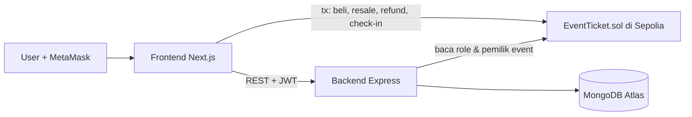

# TiketKu

TiketKu adalah dApp tiket event berbasis Ethereum (Sepolia) yang mencegah tiket palsu, calo,
transfer tidak resmi, dan check-in ganda. Setiap tiket adalah NFT ERC-721 yang hanya bisa
berpindah lewat resale resmi dengan harga maksimum 110% dari harga asli.

Proyek mini COMP6873001 Blockchain Fundamental, BINUS University.

## Struktur repo

| Folder | Isi |
|---|---|
| `ticket-chain/` | Smart contract `EventTicket.sol` (Hardhat), test, script deploy, laporan Slither |
| `backend/` | API Express + MongoDB: login wallet (SIWE + JWT), data off-chain (profil, detail event, poster, pengajuan EO) |
| `frontend/` | Next.js 14 + ethers v6: halaman pembeli, Dashboard EO, Gate scanner, Panel Admin |
| `docs/` | Panduan integrasi frontend |

## Arsitektur



- **On-chain**: event (create, read, update, delete), tiket NFT, resale, escrow dana, refund, check-in.
- **Off-chain**: profil user, deskripsi/lokasi/poster event, pengajuan menjadi Event Organizer.
- **Role** (selalu dibaca dari kontrak): Admin, Event Organizer, Gate Staff, Buyer.

## Menjalankan secara lokal

```bash
npm install                       # install workspace ticket-chain + backend

# 1. Blockchain lokal + deploy kontrak
cd ticket-chain
npx hardhat node                  # terminal 1
npm run deploy:local              # terminal 2, alamat tersimpan di deployments/localhost.json

# 2. Backend
cd ../backend
cp .env.example .env              # isi MONGODB_URI, JWT_SECRET, CONTRACT_ADDRESS, RPC_URL=http://127.0.0.1:8545, CHAIN_ID=31337
npm run dev
npm run test:login                # terminal lain: cek login & keamanan dasar

# 3. Frontend
cd ../frontend
cp .env.local.example .env.local  # NEXT_PUBLIC_CONTRACT_ADDRESS dari deployments/localhost.json
npm install
npm run dev                       # http://localhost:3000
```

Deploy ke Sepolia: lihat `ticket-chain/README.md`.

## Testing

```bash
cd ticket-chain
npm test              # 49 test, termasuk regression test keamanan
npm run coverage      # 100% statement & line coverage EventTicket.sol
npm run slither       # hasil di docs/slither-report.md
```

## Ringkasan keamanan

Kontrak:
- Transfer bebas diblokir (`_update`), tiket hanya berpindah lewat `buyResale`.
- Harga resale maksimal 110%, batas tiket per wallet (`maxPerWallet`, berlaku juga untuk resale).
- Penjualan dan resale ditutup saat acara mulai.
- Dana pembelian primer dan resale ditahan di escrow; baru cair 1 hari setelah acara.
- Event hanya bisa dibatalkan (organizer atau admin) sampai 6 jam sebelum acara, kecuali admin
  membatalkan event milik organizer yang role-nya sudah dicabut (selama dana belum diklaim). Jika batal,
  setiap pembayaran kembali ke pembayarnya: pembeli pertama dapat harga asli, pembeli resale
  dapat kembali harga resale yang dibayar.
- Organizer yang role-nya dicabut tidak bisa lagi mengatur event, gate, atau mengklaim dana.
- Check-in hanya oleh gate yang ditugaskan organizer untuk event itu, dalam jendela waktu acara,
  dan wajib menyertakan tanda tangan EIP-712 dari pemilik tiket (QR code) yang berlaku maksimal 10 menit.
- `AccessControl` (admin tidak bisa melepas role sendiri), `ReentrancyGuard`, `Pausable`, pola pull payment.
- `approve` / `setApprovalForAll` selalu ditolak; pragma dikunci `0.8.24`.

Risiko yang diterima (didokumentasikan):
- **Sybil**: batas tiket per wallet bisa diakali dengan banyak wallet. Mencegahnya butuh
  verifikasi identitas (KYC), di luar cakupan dApp ini. Batas resale 110% tetap membuat
  memborong tiket tidak menguntungkan.
- **Admin terpusat**: `DEFAULT_ADMIN_ROLE` dipegang satu akun; produksi sebaiknya multisig.

Backend:
- Login SIWE (EIP-4361), nonce sekali pakai dan tidak bisa ditimpa orang lain.
- JWT HS256 dengan issuer/audience, alamat user hanya diambil dari JWT.
- Semua input divalidasi zod `.strict()`, URL hanya `https://`.
- Upload dicek dari magic bytes, nama acak, dibatasi 20 file/jam per EO.
- Helmet, CORS terbatas, rate limit, error tidak membocorkan detail.
